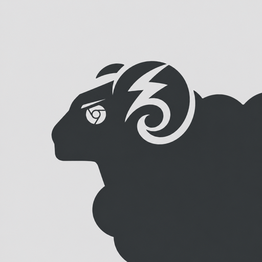
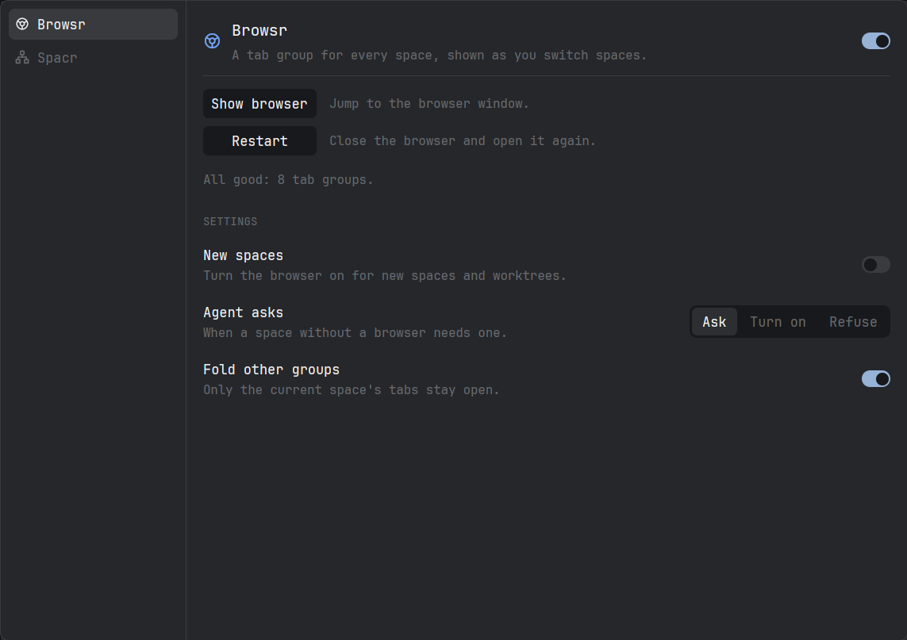

<p align="center">
  
</p>

<h1 align="center">Herdr Powr Pack</h1>

<p align="center">
  <a href="#install">install</a> · <a href="#modules">modules</a> · <a href="#for-coding-agents">for coding agents</a> · <a href="#how-it-works">how it works</a> · <a href="https://herdr.dev">herdr.dev</a>
</p>

<p align="center">
  <a href="LICENSE"></a>
  <a href="https://github.com/g00rek/herdr-powrpack/actions/workflows/check.yml"></a>
  
  
  <a href="https://x.com/michalgoreckipl"></a>
</p>

---

**A set of modules for the [Herdr](https://herdr.dev) desktop app, installed once and
switched on or off from one control panel.**

- **Browsr** — every space gets its own group of browser tabs, in a browser of
  its own. Switch spaces and the browser follows.
- **Spacr** — your projects in folders, each with its own colour and icon, with
  worktrees hanging off the project they belong to.
- **Switchr** — each Claude Code or Codex agent on the account you choose,
  moved between accounts without logging out.
- **Powr panel** — one place to switch modules on and off, see whether the
  browser is healthy, and change their settings.

<p align="center">
  
</p>

## Requirements

- Linux
- The [Herdr desktop app](https://herdr.dev) (`herdr-app`)
- Python 3.9 or newer
- For Browsr: Chromium or Google Chrome. Hyprland only for raising the browser
  window; everything else works on any window manager.
- `npx`, only for the Chrome DevTools MCP integration for coding agents

## Install

```bash
git clone https://github.com/g00rek/herdr-powrpack ~/Projects/herdr-powrpack
~/Projects/herdr-powrpack/install.py
```

The installer is safe to run again, for example after `git pull`. It:

1. finds your browser and registers the small helper that lets Browsr's
   extension talk to Herdr;
2. copies the `powr` and `spacr` mods into `~/.config/herdr-app/mods/`,
   pointed at your checkout;
3. binds `alt-b` to the Powr panel, unless you already use that key;
4. adds a **Powr Pack** button under Settings and puts Spacr in place of
   Herdr's project list. Herdr's own layouts are read-only, so a shipped
   layout is cloned first (`main-powr`) and the clone is switched to. Your old
   layout is still one `ctrl-shift-l` away.
5. makes Switchr's copy of Herdr's Agents list (see [Switchr](#switchr)) and
   lists your extra accounts in the new-agent menu.

## Modules

Open the panel with the **Powr Pack** button at the bottom of the sidebar or
`alt-b`. Each module has a switch next to its name.

### Browsr

One tab group per space, named after it. A space with two or more tabs gets a
group per tab, named `space:tab`, so switching tabs switches groups too. The space you are in is open; the
others are folded away and unfold when you switch to them. A new space gets a
group, a renamed one is renamed, a closed one takes its group with it.

Browsr drives a separate Chromium profile, with its own history and logins, so
your own browser is left alone. It never grabs the screen: the window comes
forward only when you press **Show browser**.

In the panel:

| | |
|---|---|
| **Show browser** | Jump to the browser window, starting it if needed. |
| **Restart** | Close the browser and open it again. Also reloads the extension. |
| **Resync** | Shown only when groups and spaces disagree. Matches them again. |
| **New spaces** | Turn the browser on for every new space and worktree. |
| **Agent asks** | What happens when an agent needs a browser in a space that has none: ask you, turn it on, or refuse. |
| **Fold other groups** | Only the current space's tabs stay open. |
| **Herdr links** | Links you click in Herdr open in Browsr, in the current space's group, and the browser comes to the front. Links from other programs, and from spaces without a browser, still go to your usual browser. It puts itself first in every list of link handlers (a desktop's own list included, such as Omarchy's for Hyprland) and puts each back exactly as it was when switched off. |

Under the buttons, one line says what is wrong, if anything, and which button
fixes it.

### Spacr

Replaces Herdr's project list.

- **Folders.** Make one with the folder button, drag projects into it, right-click
  it for its name, colour and icon. Folders and their projects are drawn as one
  tree.
- **Colour and icon per project.** Right-click a project's tile.
- **Worktrees under their project.** A space checked out from the same repository
  hangs off its project with a line, and shows Herdr's branch icon.
- **Browser mark.** The mark at the end of a row turns Browsr on or off for that
  space.

Settings: how strongly a folder's colour tints its background.

Switching Spacr off puts Herdr's own list back.

### Switchr

Run each Claude Code or Codex agent on the account you choose, side by side,
without logging out of anything. Your usual login is the **main** account and is
never touched; every other account is one you add.

Switchr is off after installing: switch it on in the Powr panel. Switching it
on swaps Herdr's Agents list for a copy that carries the badge and the
right-press menu; switching it off puts Herdr's own list back.

- **Adding an account.** On the Switchr page, press **Add Claude account** or
  **Add Codex account** and type a short name. A tab opens where you log in
  once. The same login can't be added twice.
- **Starting an agent on it.** The account appears in Herdr's new-agent menu as
  `Claude · <name>` or `Codex · <name>`.
- **Limits.** The page shows how much of each account's five-hour and weekly
  limit is used.
- **Moving a running agent.** Right-press it in the Agents list and pick another
  account. The agent is closed and its conversation is resumed on the new
  account in the same terminal. This works only once the agent has finished
  its turn; a busy agent says so and stays where it is.
- **The badge.** Only agents on a non-main account get a badge: the account's
  name in its row of the Agents list. An agent on main shows none.

Every extra account shares instructions, memory, skills, settings and history
with the main one; only the login is its own. So a moved agent keeps all of it.
User-wide changes made inside an extra-account session (a new MCP server, a
trusted folder, a setting changed from inside it) don't stick — make them from
a main-account session.

Codex moving was tested only with the native Codex binary. A Codex installed
through npm (a node wrapper) is not recognised yet; moving it then refuses and
leaves the agent as it is.

**Show the account in Claude Code's status line.** A status line script can
read `CLAUDE_CONFIG_DIR`: an extra account runs with
`${XDG_DATA_HOME:-~/.local/share}/switchr/claude/<name>`, and no variable means
main. This prints the account name (main's label comes from Switchr's
`accounts.json`):

```bash
#!/usr/bin/env bash
data="${XDG_DATA_HOME:-$HOME/.local/share}/switchr"
if [ -n "$CLAUDE_CONFIG_DIR" ] && [ "$(dirname "$CLAUDE_CONFIG_DIR")" = "$data/claude" ]; then basename "$CLAUDE_CONFIG_DIR"
else jq -r '.main.claude // "main"' "$data/accounts.json" 2>/dev/null || echo main; fi
```

The copy of the Agents list is made by the installer from the Agents list of
the Herdr you have, so run the installer again after a Herdr update to bring the
copy up to date. If a Herdr update changes the list too much to copy, the
installer says so; adding, starting and the new-agent menu still work, only the
badge and the right-press menu are missing.

## For coding agents

From inside a Herdr pane:

```bash
./bridge.py workspace-tabs                     # the tabs of this space, as JSON
./bridge.py open-url http://localhost:3000     # open a page without taking focus
./bridge.py status                             # what the panel shows, as JSON
```

For Claude Code, a wrapper attaches the Chrome DevTools MCP to the running
Browsr instead of launching a browser of its own:

```bash
claude mcp add --scope user chrome-devtools ~/Projects/herdr-powrpack/browsr-chrome-mcp.py
```

It puts a filter between the agent and the browser, so nothing an agent does
can raise the window or open a separate one on top of your typing. New tabs are
made in the background, in the space's group.

`skills/browsr/SKILL.md` tells an agent how to pick the right tab. Copy it to
`~/.claude/skills/browsr/SKILL.md` and replace `<browsr>` with your checkout.

## How it works

```text
Herdr app ── powr / spacr mods ──exec──► bridge.py ──► Unix socket
                                                          │
                                                   native_host.py
                                                          │ native messaging
                                          dedicated Chromium + extension
                                                          │
         coding agent ── browsr-chrome-mcp.py ────────────┘  (DevTools on 127.0.0.1:39222)
```

The extension owns the tab groups, because nothing outside a browser extension
can see them. `bridge.py` follows the space in front from the app's
`view.json`, which the app rewrites on every switch, and tells the extension.

The DevTools port is fixed at `39222`, so restarting the browser does not strand
agent sessions, and is deliberately not `9222`, which a personal Chrome answers
on. Security model: [SECURITY.md](SECURITY.md).

If your browser is not found, point at it with
`export BROWSR_CHROMIUM=/path/to/your/browser` and run the installer again.

## Uninstall

```bash
~/Projects/herdr-powrpack/bridge.py cleanup
rm -r ~/.config/herdr-app/mods/powr ~/.config/herdr-app/mods/spacr
```

Switch Switchr off in the panel first, then
`rm -r ~/.config/herdr-app/mods/switchr-agents`. Extra accounts live in
`~/.local/share/switchr/`; delete it to forget them (main is never there), and
remove the `switchr-…` entries from `~/.config/herdr-app/programs.json`.

Cleanup also gives web links back to your previous browser if Herdr links
was on. Then switch back to your old layout (`ctrl-shift-l`) and delete `main-powr`,
and remove `alt-b` from `~/.config/herdr-app/keys.json`. Cleanup leaves the
browser profile, which holds your history and logins, and prints where it is.

## Development

```bash
./scripts/check.sh
```

Runs the Python tests, the extension tests and the syntax checks.
`herdr-app check mods/<name>` loads a mod once and reports what is wrong.

This repository continues [Browsr](https://github.com/g00rek/browsr), with its
history.

## Licence

[MIT](LICENSE)
