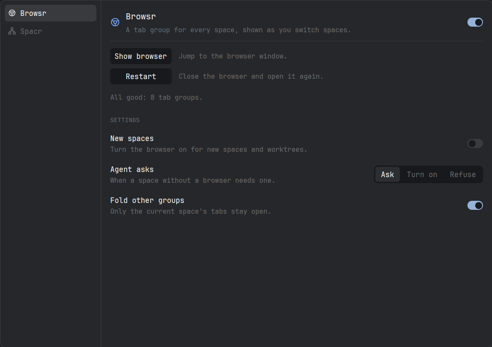

# Herdr Powr Pack

Two mods for the Herdr desktop app, the browser helper behind one of them, and
Switchr. A **Powr Pack** button under Settings opens one control panel; there,
Browsr (a tab group per space in a dedicated Chromium), Spacr (the project list
with folders, colours, icons and worktrees under their project) and Switchr (a
Claude Code or Codex account per agent) are switched on and off and set up.

## What you see

- **Sidebar footer:** a 36px row under Herdr's own footer, lightning icon and
  "Powr Pack" in the footer's style. Below 160px of sidebar only the icon.
- **Powr panel:** a centered dialog, 880×621.5 logical px, the size and place of
  Herdr's Settings. Left column: every module with icon and name, switched-off
  ones at half opacity. Right: the selected module's icon, name, one-sentence
  description and an on/off switch; under a rule, its buttons stacked, each
  110px wide with a short note beside it, then one status line, then a
  SETTINGS section of rows (name, note, control on the right).
- **Spacr list** (in place of Herdr's `spaces` block): header "spaces" with a
  new-folder and a new-space button. Folders first, each a 22px tile tinted
  with its colour at 25% under its icon, then name, project count and a
  chevron; its projects hang off the tile by 1px lines in the folder colour.
  A project is a filled 22px tile in its colour with a white icon or letter,
  its name, the branch under it when it differs, the agent status and the
  browser mark. Worktrees of the same repository hang off their project by
  lines in the project's colour, with an unframed 13px branch icon.
- **Switchr page:** two lines on how to move an agent and what the badge means,
  then a CLAUDE ACCOUNTS and a CODEX ACCOUNTS section. Each account is a row:
  name (main marked "main"), under it `5 h N% · week N%` or "Not logged in",
  then Rename and, for extra accounts, Remove. Under each section an
  "Add … account" button that turns into a name field.
- **Agents list with Switchr on** (`switchr-agents` in place of `agents`):
  Herdr's own list, plus the account name in 10px dim text in the row of an
  agent not on main. Right-press on a row opens a 240×220 popup: the accounts
  of that agent's kind with their limits, the current one marked.

## How it behaves

- Browsr page: **Show browser** raises the browser (starting it), **Restart**
  restarts it and reloads the extension, **Resync** appears only on a fault.
  Status lines end in "Click X to fix it." Settings: New spaces (switch),
  Agent asks (Ask / Turn on / Refuse), Fold other groups (switch, on),
  Herdr links (switch, off): `bridge.py links on` makes a hidden
  `powr-links.desktop` the system's http/https handler, remembering the old
  one; a link opened while Hyprland's active window has class `herdr-app`
  goes to the focused space's group in front, every other link to the old
  handler through `gtk-launch`.
- Spacr page: how to use the list, and Folder background (None / Light /
  Medium / Strong).
- Switching Spacr off swaps the layout block back to Herdr's `spaces`.
- Switchr: off by default. Switching it on needs the installer's copy of the
  Agents list and swaps the layout block `agents` → `switchr-agents`; off
  swaps it back and clears the badges. While on, the panel asks
  `switchr.py which` every 3s and stores `switchr.where` (address → account,
  only agents off main) for the badges.
- Add: type a name (`[a-z0-9][a-z0-9-]{0,23}`), Enter; a tab runs
  `switchr.py login` for the person to log in. Remove asks "Sure?" first and is
  refused while an agent runs on that account.
- Move (right-press in the Agents list, pick an account): only when the agent
  is idle or done; Switchr quits it, waits up to 20s, and resumes the same
  conversation on the new account in the same terminal. On failure the shell is
  left as it is and a notification says why.
- In the list: click selects a space; right-click a tile for colour and icon;
  right-click a row for Herdr's own menu; right-click a folder for its name,
  colour and icon; drag a project onto a folder, or below the list to take it
  out; click a folder to fold it; the browser mark toggles Browsr for that
  space. A new worktree is hidden until its repository is known (2s at most),
  so it never appears loose first.

## Built from

- `mods/powr` (`place: none`, overlay `dialog`), roles: `button` in the
  layout, the panel as its overlay. `mods/spacr` (`place: none`) in the
  sidebar's `spaces` block.
- `herdr` API: `shared`/`setShared` (keys `powr.*`, `browsr.*`, `spacr.wash`),
  `spaces`, `panes`, `layout`, `run("layout.set")`, `openOverlay`, `exec`.
- Programs: `bridge.py` (sync, launch, restart, status, off) and `git`
  (to find which spaces share a repository).
- Art: Lucide icons in `mods/spacr/icons`, Herdr's branch icon.
- Switchr: `switchr.py` (run, add, login, rename, remove, list, which, move);
  extra accounts in `~/.local/share/switchr/<kind>/<name>/`, folders whose
  entries link to the main `~/.claude` / `~/.codex` except the login, started
  with `CLAUDE_CONFIG_DIR` / `CODEX_HOME`; `programs.json` entries for the
  new-agent menu. `agents_patch.py` clones Herdr's `agents` mod
  (`mod.clone` → `switchr-agents`) and patches in the badge and right-press
  menu from `mods/switchr-agents-addon/switchr.js`.
- `install.py` copies the mods, writes the checkout's path into each
  `main.js` (`const BRIDGE`), merges `keys.json`, clones a shipped layout and
  adds the button block. It also writes `const SWITCHR`, remakes
  `switchr-agents` on every run and refreshes `programs.json`; it swaps the
  layout's `agents` block only when Switchr is already switched on.

## Watch out

- Mods run commands (`exec`): `bridge.py` and `git`. Browsr starts a Chromium
  with DevTools on 127.0.0.1:39222.
- A render that does too much is interrupted by Herdr; Spacr works out each
  row's project and folder once per render.
- Never write the app's `shared.json` from outside the app.

## Done when

- `herdr-app check` passes for both mods and for `switchr-agents`.
- With Switchr on, an agent on an extra account shows its name in the Agents
  list, and a move resumes the same conversation on the chosen account.
- The Powr Pack button opens the panel at Settings' size and place.
- Switching spaces brings that space's tab group forward in the browser.
- A worktree appears under its project, never loose first.
